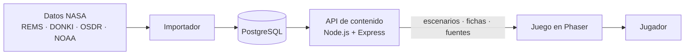

# JIIMATZIN — Junior Astronaut Mission Trainer

Aventura web 2D para niños de 7 a 12 años. Durante diez soles, el jugador administra una base en Marte: reparte energía, cuida el oxígeno y el blindaje, resuelve minijuegos y decide cómo responder a emergencias. Cada decisión tiene costos, y cada noche el juego explica el porqué con **datos reales de misiones de la NASA**.

Proyecto para NASA Space Apps Challenge 2026 · *Build a Junior Astronaut Mission Trainer*.

## Cómo funciona



- **Escenarios:** condiciones ambientales y eventos reales (clima espacial, temperatura y presión en Marte) seleccionados para cada sol del juego.
- **Fichas «Dato real»:** explicaciones para niños, respaldadas por evidencia y con la fuente a la vista.
- **Procedencia:** cada dato conserva su origen, su fecha y su calidad; los valores faltantes nunca se convierten en medidas.
- **Modo histórico:** el juego presenta datos de capturas fechadas y lo indica de forma explícita.

## Estructura

```
jiimatzin/
├── backend/          API de contenido (Node.js, Express 5, PostgreSQL)
│   ├── migrations/   esquema versionado
│   └── src/
│       ├── escenarios/        misiones y condiciones
│       ├── fichas/            fichas «Dato real» y su evidencia
│       ├── fuentes/           procedencia y atribución
│       ├── salud/             estado del servicio
│       ├── importador/        carga de datos
│       ├── compartido/        errores de aplicación
│       └── infraestructura/   configuración, base de datos y middlewares
├── frontend/         juego en Phaser y adaptador de la API
├── contrato/         JSON Schema del escenario, compartido por back y front
├── docs/             documentación técnica con diagramas
└── scripts/          validación de commits y de gestor de paquetes
```

Cada funcionalidad del backend reúne su modelo, vista JSON, controlador, rutas y repositorio. Detalle en [backend/README.md](backend/README.md).

## Puesta en marcha

Requisitos: Node ≥ 22.9, pnpm (`corepack enable`) y Docker (o un PostgreSQL local).

```bash
cp .env.example .env
pnpm install
pnpm db:up
pnpm migrar
pnpm dev:back
```

Comprobar: <http://localhost:3000/health> y <http://localhost:3000/api/v1/scenarios>.

| Comando | Qué hace |
| --- | --- |
| `pnpm dev:back` | API con recarga automática (puerto 3000) |
| `pnpm dev:front` | Servidor de desarrollo del frontend |
| `pnpm db:up` / `db:down` | Inicia / detiene PostgreSQL 17 en Docker (puerto 5433) |
| `pnpm migrar` / `migrar:revertir` | Aplica / revierte migraciones |
| `pnpm test` | Pruebas del backend |

Con un PostgreSQL propio: apunta `DATABASE_URL` en `.env` a tu instancia, omite `pnpm db:up` y ejecuta `pnpm migrar`.

## API

| Ruta | Respuesta |
| --- | --- |
| `GET /health` · `GET /health/listo` | Estado del servicio y de la base de datos |
| `GET /api/v1/scenarios` | Escenarios publicados |
| `GET /api/v1/scenarios/{id}?version=` | Escenario completo con condiciones y fichas |
| `GET /api/v1/facts/{id}?lang=` | Ficha con evidencias y referencias |
| `GET /api/v1/sources/{id}` | Atribución y contexto de una fuente |

Formato y errores en [docs/04-api.md](docs/04-api.md).

## Calidad y producción

- API de solo lectura con SQL parametrizado, `helmet`, CORS cerrado, límite de peticiones y caché controlada.
- En producción toda la configuración llega por variables de entorno y la API rechaza arrancar con valores inseguros. Ver [docs/06-produccion.md](docs/06-produccion.md).
- Pruebas automatizadas de rutas, validación, errores y configuración.

## Hoja de ruta

1. **Base de datos e importador:** carga de REMS, DONKI, NOAA y OSDR con verificación de hashes y política de calidad. *(en curso)*
2. **Endpoints con datos reales:** pruebas de integración, publicación de escenarios y respaldo estático.
3. **Integración con el juego:** carga de escenarios desde Phaser.
4. **Despliegue en Google Cloud.**

Guía paso a paso en [docs/07-guia-desarrollo.md](docs/07-guia-desarrollo.md).

## Documentación y colaboración

- Índice técnico: [docs/README.md](docs/README.md)
- Convención de commits y ramas: [CONTRIBUTING.md](CONTRIBUTING.md)
- Solo se usa **pnpm**: con npm o yarn la instalación se detiene.
