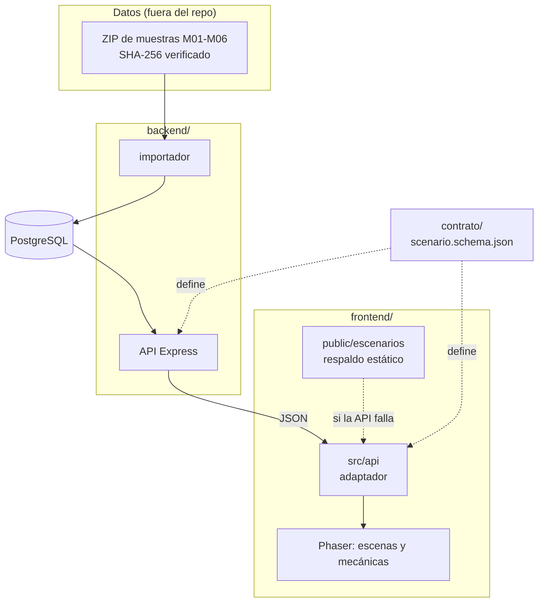
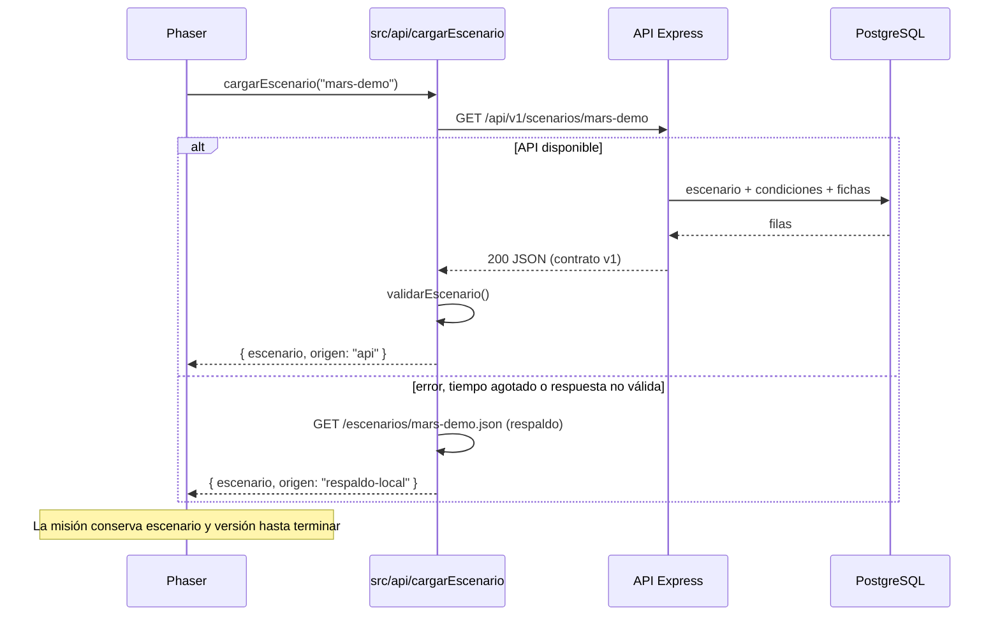
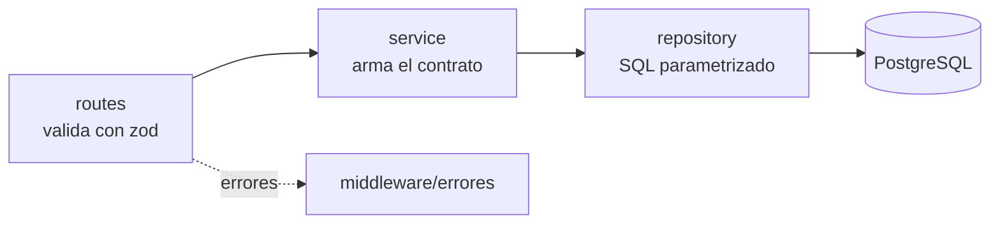
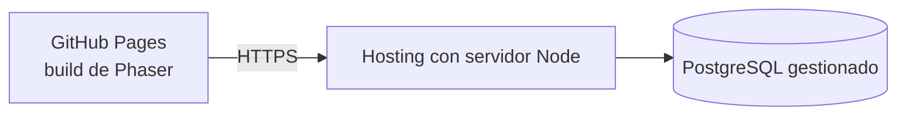

# Arquitectura

## Componentes y responsabilidades

| Componente | Responsable propuesto (doc 04) |
| --- | --- |
| Importación, BD, endpoints de contenido | Rol 3 |
| Adaptador HTTP y carga en Phaser | Rol 1 |
| Reglas, efectos y balance | Rol 2 |
| Texto de historia y etiquetas | Rol 5, con revisión científica del rol 3 |

Principios: el frontend **nunca** se conecta a la BD; el backend **no** consulta NASA por jugador; la lógica de recursos del juego queda en el módulo de mecánicas, no en la API.

## Carga de un escenario

## Estructura interna del backend

## Conexión front ↔ back

| Entorno | Cómo se conectan |
| --- | --- |
| Desarrollo | Vite (5173) con proxy `/api` → `localhost:3000`; sin CORS |
| Producción, mismo dominio | Proxy inverso: `/api` hacia la API |
| Producción, dominios distintos | `VITE_API_URL` apunta a la API y `CORS_ORIGINS` incluye el origen del front |

## Despliegue (sin confirmar)

GitHub Pages solo sirve estáticos: los endpoints dinámicos necesitan un host con ejecución de servidor y acceso a PostgreSQL. Ningún proveedor está elegido. Requisitos: `DATABASE_URL` solo en servidor, lista de orígenes CORS, copias de seguridad.
