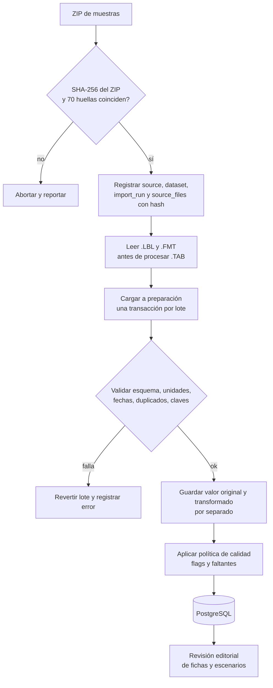

# Importación de datos

> Estado: **diseño**. [backend/src/importador/cli.js](../backend/src/importador/cli.js) es un esqueleto y no importa nada. Hallazgos de partida: documento 03 de contexto.

## Reglas por lote

| Lote | Qué entra | Reglas |
| --- | --- | --- |
| M01 DONKI | 29 CME → `external_records` | Conservar valores ausentes; no etiquetar como dosis ni peligro; el lote FLR (404) es intento fallido |
| M02 REMS | 144 620 filas RMD → `observations` | −999 → faltante (conservar original). Marcar los 120 casos con bit 8 = 0 (sol 11 y 13). No exigir cadena de unos en todos los flags. Resumen actual = exploratorio (`quality_policy = not_applied`) |
| M03 OSDR | OSD-268, OSD-177, OSD-767 → `studies` | Separar `mission_*` de `experiment_*`. `uso_candidato`/`limite` son interpretación editorial, no metadatos NASA |
| M04 NOAA | 106 registros → `external_records` | La unidad «por confirmar» no se importa como validada; no mezclar con CME de 2024 |
| M05 RadLab | Error 500 | Solo `import_runs` + `source_files` (`error_response`); ninguna dosimetría |
| M06 Referencias | Fichas | Solo como borrador (`draft`) hasta cotejar cada afirmación |

## Idempotencia

Reejecutar el importador no duplica: la captura se identifica por `(uri, sha256)`, los registros por `(dataset_id, external_id, revision)` y las observaciones por `(source_file_id, record_index, variable)`. Una revisión nueva se añade, nunca sobrescribe la usada por un escenario publicado.

## Decisiones pendientes antes de implementar

1. Política de calidad REMS (qué flags excluyen, qué solo se marcan) y revisar `DATA_EVENTS.TXT`.
2. Dónde guardar los originales (ruta fuera del repo, `DATA_DIR`) y su respaldo.
3. Tabla editorial para interpretaciones (autor, evidencia, estado de revisión).
