# Diagrama ER del esquema ciencia

Generado desde la migración con `node scripts/documentar-bd.mjs`.
Incluye las 28 tablas y todas las FK declaradas. Los nodos muestran columnas PK/FK;
las demás columnas y restricciones se consultan en el [diccionario](10-diccionario-bd.md).

La notación distingue FK obligatorias y opcionales, con cero o más hijos; los cinco
subtipos de `processed_records` tienen como máximo una fila por registro.
El DDL exige el tipo correcto del subtipo, pero no exige su existencia al
insertar el registro padre: ese cierre lo verifican el importador y el control de publicación.

`release_resources` referencia claves lógicas de metadatos mediante JSON; esa
relación se verifica contra el ZIP y no añade FK SQL hacia cada tabla. Ver
[12-publicacion.md](12-publicacion.md).

```mermaid
erDiagram
    sources {
        text source_id PK
    }
    datasets {
        text dataset_id PK
        text source_id FK
    }
    sources ||--o{ datasets : source_id
    source_files {
        text source_file_id PK
    }
    source_file_locations {
        bigint location_id PK
        text source_file_id FK
    }
    source_files ||--o{ source_file_locations : source_file_id
    captures {
        text capture_id PK
    }
    capture_files {
        text capture_id PK,FK
        text source_file_id PK,FK
        text role PK
    }
    captures ||--o{ capture_files : capture_id
    source_files ||--o{ capture_files : source_file_id
    quality_policies {
        text policy_id PK
    }
    processors {
        text processor_id PK
        text policy_id FK
    }
    quality_policies |o--o{ processors : policy_id
    dataset_releases {
        text release_id PK
        text processor_id FK
    }
    processors ||--o{ dataset_releases : processor_id
    import_runs {
        bigint import_run_id PK
        text release_id FK
    }
    dataset_releases ||--o{ import_runs : release_id
    processed_records {
        text record_id PK
        text dataset_id FK
        text processor_id FK
        text selection_policy_id FK
    }
    datasets ||--o{ processed_records : dataset_id
    processors ||--o{ processed_records : processor_id
    quality_policies |o--o{ processed_records : selection_policy_id
    record_source_refs {
        text record_id PK,FK
        integer ref_index PK
        text source_file_id FK
    }
    processed_records ||--o{ record_source_refs : record_id
    source_files ||--o{ record_source_refs : source_file_id
    release_members {
        text release_id PK,FK
        text record_id PK,FK
    }
    dataset_releases ||--o{ release_members : release_id
    processed_records ||--o{ release_members : record_id
    observations {
        text record_id PK,FK
        text record_type FK
    }
    processed_records ||--o| observations : record_id_record_type
    environment_hours {
        text record_id PK,FK
        text record_type FK
    }
    processed_records ||--o| environment_hours : record_id_record_type
    lineage_members {
        text aggregate_record_id PK,FK
        text observation_record_id PK,FK
        text role PK
    }
    environment_hours ||--o{ lineage_members : aggregate_record_id
    observations ||--o{ lineage_members : observation_record_id
    instrument_events {
        text source_file_id PK,FK
        text event_annotation_id PK
    }
    source_files ||--o{ instrument_events : source_file_id
    hour_event_annotations {
        text aggregate_record_id PK,FK
        text annotation_source_file_id PK,FK
        text event_annotation_id PK,FK
    }
    environment_hours ||--o{ hour_event_annotations : aggregate_record_id
    instrument_events ||--o{ hour_event_annotations : annotation_source_file_id_event_annotation_id
    solar_events {
        text record_id PK,FK
        text record_type FK
    }
    processed_records ||--o| solar_events : record_id_record_type
    radiation_samples {
        text record_id PK,FK
        text record_type FK
    }
    processed_records ||--o| radiation_samples : record_id_record_type
    studies {
        text accession PK
        text source_file_id PK,FK
    }
    source_files ||--o{ studies : source_file_id
    fact_cards {
        text record_id PK,FK
        text record_type FK
    }
    processed_records ||--o| fact_cards : record_id_record_type
    fact_evidence {
        text fact_record_id PK,FK
        integer evidence_index PK
        text source_file_id FK
    }
    fact_cards ||--o{ fact_evidence : fact_record_id
    source_files ||--o{ fact_evidence : source_file_id
    mechanics {
        text mechanic_id PK
    }
    fact_mechanics {
        text fact_record_id PK,FK
        text mechanic_id PK,FK
    }
    fact_cards ||--o{ fact_mechanics : fact_record_id
    mechanics ||--o{ fact_mechanics : mechanic_id
    fact_reviews {
        bigint review_id PK
        text fact_record_id FK
    }
    fact_cards ||--o{ fact_reviews : fact_record_id
    publication_events {
        bigint event_id PK
        text release_id FK
    }
    dataset_releases ||--o{ publication_events : release_id
    release_resources {
        text release_id PK,FK
        text table_name PK
        jsonb resource_key PK
    }
    dataset_releases ||--o{ release_resources : release_id
```

Fuente Mermaid independiente: [ciencia-er.mmd](diagramas/ciencia-er.mmd).

Para obtener un ER con todas las columnas de tu instancia real, genera el
diagrama en pgAdmin siguiendo la [guía de acceso](09-acceso-postgresql-local.md).
