# Modelo y diccionario de juego

Generado con `node scripts/documentar-juego.mjs` desde las migraciones 20261117 y 20261118.
Incluye 19 tablas: cinco de escenarios y catorce de catálogos y vínculos.
Los tipos, campos, claves y restricciones se conservan en las declaraciones SQL. Las relaciones usan NO ACTION.
La tabla `ciencia.release_members` está fuera de este esquema; fija las revisiones científicas.

## Relaciones

```mermaid
erDiagram
    game_rule_sets {
        text referencia "Ver DDL completo"
    }
    scenarios {
        text referencia "Ver DDL completo"
    }
    ciencia_dataset_releases ||--o{ scenarios : referencia
    game_rule_sets ||--o{ scenarios : referencia
    scenario_records {
        text referencia "Ver DDL completo"
    }
    scenarios ||--o{ scenario_records : referencia
    ciencia_release_members ||--o{ scenario_records : referencia
    scenario_facts {
        text referencia "Ver DDL completo"
    }
    ciencia_fact_cards ||--o{ scenario_facts : referencia
    scenarios ||--o{ scenario_facts : referencia
    ciencia_release_members ||--o{ scenario_facts : referencia
    scenario_events {
        text referencia "Ver DDL completo"
    }
    scenarios ||--o{ scenario_events : referencia
    catalogos {
        text referencia "Ver DDL completo"
    }
    recursos {
        text referencia "Ver DDL completo"
    }
    catalogos ||--o{ recursos : referencia
    personajes {
        text referencia "Ver DDL completo"
    }
    catalogos ||--o{ personajes : referencia
    datos_narrativos {
        text referencia "Ver DDL completo"
    }
    catalogos ||--o{ datos_narrativos : referencia
    minijuegos {
        text referencia "Ver DDL completo"
    }
    catalogos ||--o{ minijuegos : referencia
    recursos ||--o{ minijuegos : referencia
    datos_narrativos ||--o{ minijuegos : referencia
    emergencias {
        text referencia "Ver DDL completo"
    }
    catalogos ||--o{ emergencias : referencia
    datos_narrativos ||--o{ emergencias : referencia
    opciones_emergencia {
        text referencia "Ver DDL completo"
    }
    emergencias ||--o{ opciones_emergencia : referencia
    recursos ||--o{ opciones_emergencia : referencia
    cartas_mejora {
        text referencia "Ver DDL completo"
    }
    catalogos ||--o{ cartas_mejora : referencia
    datos_narrativos ||--o{ cartas_mejora : referencia
    recursos ||--o{ cartas_mejora : referencia
    finales {
        text referencia "Ver DDL completo"
    }
    catalogos ||--o{ finales : referencia
    datos_narrativos ||--o{ finales : referencia
    soles {
        text referencia "Ver DDL completo"
    }
    catalogos ||--o{ soles : referencia
    minijuegos ||--o{ soles : referencia
    emergencias ||--o{ soles : referencia
    audio {
        text referencia "Ver DDL completo"
    }
    catalogos ||--o{ audio : referencia
    variables {
        text referencia "Ver DDL completo"
    }
    catalogos ||--o{ variables : referencia
    scenario_content {
        text referencia "Ver DDL completo"
    }
    catalogos ||--o{ scenario_content : referencia
    scenarios ||--o{ scenario_content : referencia
    vinculos_datos {
        text referencia "Ver DDL completo"
    }
    scenario_content ||--o{ vinculos_datos : referencia
    datos_narrativos ||--o{ vinculos_datos : referencia
    scenario_facts ||--o{ vinculos_datos : referencia
```



## Tablas

### game_rule_sets

```sql
CREATE TABLE juego.game_rule_sets (
  rules_version text PRIMARY KEY CHECK (rules_version ~ '^[a-z0-9][a-z0-9_.-]{0,95}$'),
  definition jsonb NOT NULL CHECK (jsonb_typeof(definition)='object'),
  published_at timestamptz
);
```

### scenarios

```sql
CREATE TABLE juego.scenarios (
  scenario_id text, version integer CHECK (version>0),
  release_id text NOT NULL REFERENCES ciencia.dataset_releases,
  rules_version text NOT NULL REFERENCES juego.game_rule_sets,
  language text NOT NULL CHECK (language ~ '^[a-z]{2}$'),
  title text NOT NULL CHECK (length(btrim(title)) BETWEEN 1 AND 200),
  model_assumptions jsonb NOT NULL DEFAULT '[]' CHECK (jsonb_typeof(model_assumptions)='array'),
  publication_status text NOT NULL DEFAULT 'draft' CHECK (publication_status IN ('draft','published','retired')),
  published_at timestamptz,
  PRIMARY KEY (scenario_id,version), UNIQUE (scenario_id,version,release_id),
  CHECK (scenario_id ~ '^[a-z0-9][a-z0-9_-]{0,63}$'),
  CHECK ((publication_status='draft')=(published_at IS NULL))
);
```

### scenario_records

```sql
CREATE TABLE juego.scenario_records (
  scenario_id text, scenario_version integer, release_id text NOT NULL, position integer CHECK (position>=0),
  record_id text NOT NULL, role text NOT NULL CHECK (role IN ('environment','reference')),
  game_sol integer NOT NULL CHECK (game_sol BETWEEN 1 AND 10),
  game_phase text CHECK (game_phase IN ('morning','day','emergency','night')),
  justification text NOT NULL CHECK (length(btrim(justification)) BETWEEN 1 AND 2000),
  PRIMARY KEY (scenario_id,scenario_version,position),
  FOREIGN KEY (scenario_id,scenario_version,release_id) REFERENCES juego.scenarios(scenario_id,version,release_id),
  FOREIGN KEY (release_id,record_id) REFERENCES ciencia.release_members
);
```

### scenario_facts

```sql
CREATE TABLE juego.scenario_facts (
  scenario_id text, scenario_version integer, release_id text NOT NULL, position integer CHECK (position>=0),
  record_id text NOT NULL REFERENCES ciencia.fact_cards,
  game_sol integer CHECK (game_sol BETWEEN 1 AND 10),
  game_phase text CHECK (game_phase IN ('morning','day','emergency','night')),
  PRIMARY KEY (scenario_id,scenario_version,position), UNIQUE (scenario_id,scenario_version,record_id),
  FOREIGN KEY (scenario_id,scenario_version,release_id) REFERENCES juego.scenarios(scenario_id,version,release_id),
  FOREIGN KEY (release_id,record_id) REFERENCES ciencia.release_members
);
```

### scenario_events

```sql
CREATE TABLE juego.scenario_events (
  event_id bigint GENERATED ALWAYS AS IDENTITY PRIMARY KEY,
  scenario_id text NOT NULL, scenario_version integer NOT NULL,
  FOREIGN KEY (scenario_id,scenario_version) REFERENCES juego.scenarios(scenario_id,version),
  action text NOT NULL CHECK (action IN ('created','published','retired')),
  actor_ref text NOT NULL CHECK (length(btrim(actor_ref)) BETWEEN 1 AND 200),
  database_actor text NOT NULL DEFAULT session_user,
  occurred_at timestamptz NOT NULL DEFAULT clock_timestamp(), transaction_id bigint NOT NULL DEFAULT txid_current(),
  reason text
);
```

### catalogos

```sql
CREATE TABLE juego.catalogos (
  catalog_id text PRIMARY KEY CHECK (catalog_id ~ '^cat_[0-9a-f]{64}$'),
  content_sha256 text NOT NULL UNIQUE CHECK (content_sha256 ~ '^[0-9a-f]{64}$'),
  source_sha256 text NOT NULL CHECK (source_sha256 ~ '^[0-9a-f]{64}$'),
  source_version text NOT NULL, document jsonb NOT NULL CHECK (jsonb_typeof(document)='object'),
  imported_at timestamptz NOT NULL DEFAULT clock_timestamp(),
  actor_ref text NOT NULL CHECK(length(btrim(actor_ref)) BETWEEN 1 AND 200),
  database_actor text NOT NULL DEFAULT session_user, sealed boolean NOT NULL DEFAULT false
);
```

### recursos

```sql
CREATE TABLE juego.recursos (
  catalog_id text REFERENCES juego.catalogos, id text, payload jsonb NOT NULL,
  PRIMARY KEY(catalog_id,id), CHECK(id IN ('energia','oxigeno','blindaje'))
);
```

### personajes

```sql
CREATE TABLE juego.personajes (
  catalog_id text REFERENCES juego.catalogos, id text, nombre text NOT NULL, rol text NOT NULL,
  jugable boolean NOT NULL, payload jsonb NOT NULL, PRIMARY KEY(catalog_id,id)
);
```

### datos_narrativos

```sql
CREATE TABLE juego.datos_narrativos (
  catalog_id text REFERENCES juego.catalogos, id text, payload jsonb NOT NULL,
  PRIMARY KEY(catalog_id,id)
);
```

### minijuegos

```sql
CREATE TABLE juego.minijuegos (
  catalog_id text REFERENCES juego.catalogos, id text, recurso text NOT NULL, dato_id text,
  gana integer NOT NULL CHECK(gana BETWEEN 1 AND 3), falla integer NOT NULL CHECK(falla BETWEEN -3 AND -1),
  payload jsonb NOT NULL, PRIMARY KEY(catalog_id,id),
  FOREIGN KEY(catalog_id,recurso) REFERENCES juego.recursos,
  FOREIGN KEY(catalog_id,dato_id) REFERENCES juego.datos_narrativos
);
```

### emergencias

```sql
CREATE TABLE juego.emergencias (
  catalog_id text REFERENCES juego.catalogos, id text, sol_sugerido integer CHECK(sol_sugerido BETWEEN 1 AND 10),
  dato_id text, payload jsonb NOT NULL, PRIMARY KEY(catalog_id,id),
  FOREIGN KEY(catalog_id,dato_id) REFERENCES juego.datos_narrativos
);
```

### opciones_emergencia

```sql
CREATE TABLE juego.opciones_emergencia (
  catalog_id text, emergencia_id text, position integer CHECK(position>=0), recurso text NOT NULL,
  cambio integer NOT NULL CHECK(cambio BETWEEN -3 AND -1), texto text NOT NULL,
  PRIMARY KEY(catalog_id,emergencia_id,position),
  FOREIGN KEY(catalog_id,emergencia_id) REFERENCES juego.emergencias,
  FOREIGN KEY(catalog_id,recurso) REFERENCES juego.recursos
);
```

### cartas_mejora

```sql
CREATE TABLE juego.cartas_mejora (
  catalog_id text REFERENCES juego.catalogos, id text, dato_id text, costo_recurso text,
  costo_cambio integer CHECK(costo_cambio BETWEEN -3 AND -1), payload jsonb NOT NULL,
  PRIMARY KEY(catalog_id,id), CHECK((costo_recurso IS NULL)=(costo_cambio IS NULL)),
  FOREIGN KEY(catalog_id,dato_id) REFERENCES juego.datos_narrativos,
  FOREIGN KEY(catalog_id,costo_recurso) REFERENCES juego.recursos
);
```

### finales

```sql
CREATE TABLE juego.finales (
  catalog_id text REFERENCES juego.catalogos, id text, dato_id text, payload jsonb NOT NULL,
  PRIMARY KEY(catalog_id,id), FOREIGN KEY(catalog_id,dato_id) REFERENCES juego.datos_narrativos
);
```

### soles

```sql
CREATE TABLE juego.soles (
  catalog_id text REFERENCES juego.catalogos, sol integer CHECK(sol BETWEEN 1 AND 10),
  minijuego_id text, emergencia_id text, payload jsonb NOT NULL, PRIMARY KEY(catalog_id,sol),
  FOREIGN KEY(catalog_id,minijuego_id) REFERENCES juego.minijuegos,
  FOREIGN KEY(catalog_id,emergencia_id) REFERENCES juego.emergencias
);
```

### audio

```sql
CREATE TABLE juego.audio (
  catalog_id text REFERENCES juego.catalogos, tipo text CHECK(tipo IN ('musica','sfx')), etiqueta text,
  asset_id text NOT NULL, PRIMARY KEY(catalog_id,tipo,etiqueta)
);
```

### variables

```sql
CREATE TABLE juego.variables (
  catalog_id text REFERENCES juego.catalogos, nombre text, tipo text NOT NULL,
  PRIMARY KEY(catalog_id,nombre)
);
```

### scenario_content

```sql
CREATE TABLE juego.scenario_content (
  scenario_id text, scenario_version integer, catalog_id text NOT NULL REFERENCES juego.catalogos,
  initial_resources jsonb NOT NULL CHECK(jsonb_typeof(initial_resources)='object'
    AND initial_resources ?& ARRAY['energia','oxigeno','blindaje']
    AND initial_resources - ARRAY['energia','oxigeno','blindaje'] = '{}'::jsonb
    AND initial_resources->'energia' IN ('1'::jsonb,'2'::jsonb,'3'::jsonb)
    AND initial_resources->'oxigeno' IN ('1'::jsonb,'2'::jsonb,'3'::jsonb)
    AND initial_resources->'blindaje' IN ('1'::jsonb,'2'::jsonb,'3'::jsonb)),
  PRIMARY KEY(scenario_id,scenario_version), UNIQUE(scenario_id,scenario_version,catalog_id),
  FOREIGN KEY(scenario_id,scenario_version) REFERENCES juego.scenarios
);
```

### vinculos_datos

```sql
CREATE TABLE juego.vinculos_datos (
  scenario_id text, scenario_version integer, catalog_id text, narrative_id text, record_id text,
  justification text NOT NULL CHECK(length(btrim(justification)) BETWEEN 1 AND 2000),
  PRIMARY KEY(scenario_id,scenario_version,narrative_id,record_id),
  FOREIGN KEY(scenario_id,scenario_version,catalog_id) REFERENCES juego.scenario_content(scenario_id,scenario_version,catalog_id),
  FOREIGN KEY(catalog_id,narrative_id) REFERENCES juego.datos_narrativos,
  FOREIGN KEY(scenario_id,scenario_version,record_id) REFERENCES juego.scenario_facts(scenario_id,scenario_version,record_id)
);
```

## Protección y procedencia

`catalogos` conserva la versión declarada, SHA-256 del archivo, hash semántico, documento original, fecha y actor.
Las filas del catálogo se cargan en una transacción y se sellan. Los triggers impiden cambios posteriores,
relaciones añadidas y TRUNCATE; una corrección requiere otra identidad. El sello del catálogo conserva contenido
y no representa una aprobación científica ni publicación de escenario.
`scenario_content` fija catálogo y recursos iniciales; `vinculos_datos` relaciona entradas narrativas con fichas
ya seleccionadas en el escenario. Los vínculos son referencias complementarias, no aprobaciones de los textos originales.
La protección de esas selecciones exige escenario borrador y READ COMMITTED. El retiro conserva las revisiones.
La reversión se rechaza cuando el catálogo está vinculado a cualquier escenario que haya sido publicado.

Los payloads de `datos_narrativos` son administrativos y no se entregan en las respuestas públicas.
Los archivos de audio/imagen y el estado mutable de las partidas no se guardan en estas tablas.
